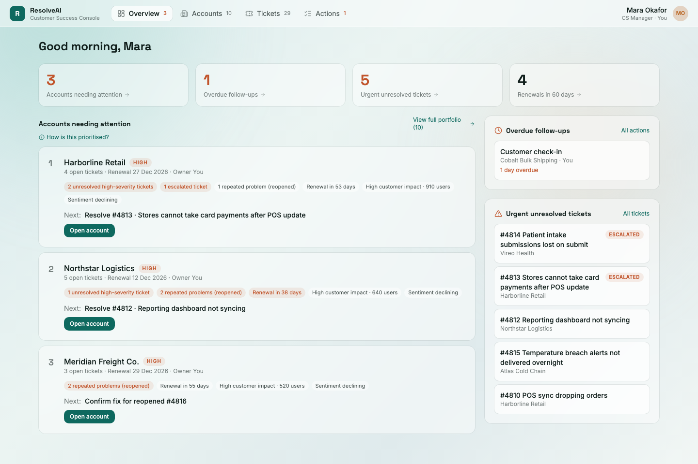

# Resolve AI

[](https://github.com/klementinadzo/pixel-triage-buddy/actions/workflows/ci.yml)

**Who it's for:** Customer Success managers who look after a portfolio of business customers, like Mara, who manages ten accounts.

**Why it exists:** the warning signs of an unhappy customer are scattered across support tickets, missed follow-ups and approaching renewals, so problems are often noticed too late. Resolve AI brings them into one place, shows which accounts need attention first and why, and uses AI to brief the manager on every ticket, so they can act before a customer is at risk.

[Features](#features) · [Getting started](#getting-started) · [How it works](#how-it-works) · [Docs](docs/) · [Roadmap](#limitations-and-roadmap)



All data is fictional.

## Features

- **Know where to start.** The Overview ranks accounts by real problems (severity, repeat issues, overdue follow-ups, renewals), not by contract size.
- **See everything about an account at once:** tickets, follow-ups, risk level and an activity timeline.
- **Urgent tickets first.** High priority on top, with escalated and reopened tickets leading.
- **An AI briefing for every ticket:** the key facts in a few short points, the next steps, and a reply already in the draft.
- **Nothing gets lost.** Status changes, notes, drafts, replies, follow-ups and risk are saved and survive a refresh.
- **Rules you can trust,** enforced on the server: resolving needs a note, and resolving a ticket never quietly lowers an account's risk.

## Tech stack

| Part    | Technology                                                                                      |
| ------- | ----------------------------------------------------------------------------------------------- |
| App     | TanStack Start (React 19, server functions), Tailwind CSS, Vite                                 |
| Data    | Supabase (Postgres), accessed only from the server                                              |
| AI      | Google Gemini (free tier), called from the server                                               |
| Quality | TypeScript, Vitest (62 tests, incl. database tests on PGlite), ESLint, Prettier, GitHub Actions |
| Origin  | Prototype built in [Lovable](https://lovable.dev), extended with Claude Code                    |

## Getting started

You need [Bun](https://bun.sh) and Node.js **22.12 or newer**.

1. **Install:** `bun install --frozen-lockfile`
2. **Create a free [Supabase](https://supabase.com) project**, then copy `.env.local.example` to `.env.local` and fill it in (Project Settings → API keys, and Connect → Session pooler). Add a free [Gemini key](https://aistudio.google.com) as `AI_API_KEY` for the AI briefing. Never commit `.env.local`.
3. **Create the tables and demo data:** `bun run db:apply`, then `bun run db:seed`
4. **Run it:** `bun run dev`, then open http://localhost:8080. The health check at `/api/health` should show `"accounts": 10`.

| Command             | What it does                                   |
| ------------------- | ---------------------------------------------- |
| `bun run dev`       | Starts the app on localhost:8080               |
| `bun run test`      | Runs the unit and database tests               |
| `bun run lint`      | Checks code and formatting                     |
| `bun run build`     | Production build                               |
| `bun run db:status` | Shows which migrations are applied (read-only) |
| `bun run db:seed`   | Loads the demo data (`--reset` starts over)    |
| `bun run db:types`  | Regenerates the database types from the schema |

More: [configuration and running in Lovable](docs/configuration.md) · [database](docs/database.md).

## How it works

```
Button in the UI → workspace action hook (screen updates at once)
  → server function (checks the input)
    → database function (change + timeline entry in one transaction)
      → saved data reloads, so every screen and the ranking agree
```

- **Ranking:** accounts score points for urgent tickets, repeat problems, overdue follow-ups, a near renewal, size, declining sentiment and risk. An urgent ticket always flags the account; the Overview shows the High-risk ones.
- **Tickets:** ordered by priority, then escalated, reopened and newest. Statuses are Open, Escalated and Resolved.
- **Dates** follow the real calendar, so overdue follow-ups and renewals update by themselves.
- **AI briefing:** the server sends the ticket and its account context to Gemini and gets back short labelled facts, next steps and a reply that uses only facts from the ticket. It is saved, refreshes after Send, and is limited to 50 requests a day.
- **Send** adds the reply to the conversation and timeline. Email delivery isn't connected yet; the confirmation says so.

Why it is built this way: [key decisions](docs/decisions.md).

## Project structure

| Path                                     | Contents                                                       |
| ---------------------------------------- | -------------------------------------------------------------- |
| `src/routes/`                            | Pages: Overview, Accounts, account workspace, Tickets, Actions |
| `src/components/`                        | App shell, follow-up dialog, UI components                     |
| `src/domain/`                            | Data types, ranking rules and the current user                 |
| `src/lib/workspace/`                     | Shared workspace data, actions and hooks                       |
| `src/components/console/`                | Account workspace: sidebar, ticket view, AI card, risk panel   |
| `src/lib/workspace.functions.ts`         | Server functions for every read and write                      |
| `src/lib/ai-gateway.server.ts`           | The AI request: prompt, provider, retries                      |
| `src/lib/database.types.ts`              | Database types, generated by `bun run db:types`                |
| `src/test/`                              | Unit tests and database tests                                  |
| `db/migrations/`, `db/seed/`             | Structure changes (`db:apply`) and demo data (`db:seed`)       |
| `docs/`                                  | Configuration, database and decision notes                     |
| `src/integrations/supabase/`, `drizzle/` | Generated by Lovable (do not edit); the app doesn't use them   |

## Limitations and roadmap

**Today**

- **No sign-in:** anyone with the app link can change the shared, fictional data. Don't use it for real customers.
- Everyone shares one dataset and every change is attributed to "You".
- The "Knowledge" box shows demo article titles and isn't used by the AI.

**Next**

- Email integration, so **Send** delivers the reply.
- Sign-in, so only the account manager can make changes.
- Retrieval (RAG) for the Knowledge box: give the AI relevant help articles and past fixes.

## Credits and copyright

Built by Klementina Angeleski. Prototype made with [Lovable](https://lovable.dev); backend, AI integration and business rules added with Claude Code. The repository syncs with Lovable, so please don't force-push or rewrite pushed history. Security notes: [SECURITY.md](SECURITY.md). © 2026 Klementina Angeleski. All rights reserved; see [LICENSE](LICENSE).
